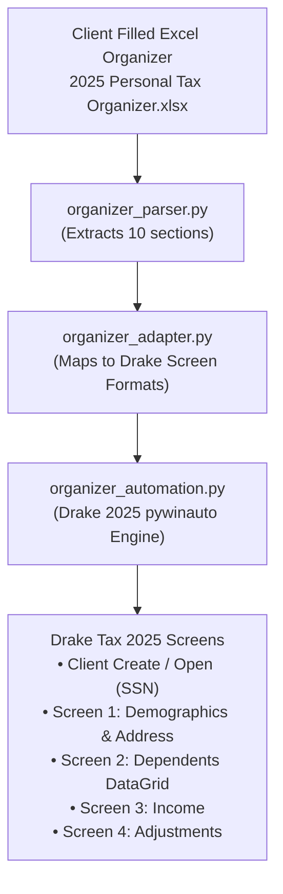

# Drake Tax 2025 - Dynamic Tax Organizer Automation

This folder contains the complete, dedicated automation system that dynamically parses client-filled **`2025 Personal Tax Organizer.xlsx`** workbooks and automatically populates the data into **Drake Tax 2025**.

---

## Architecture Overview



---

## File Structure

| File | Purpose |
| :--- | :--- |
| **`organizer_parser.py`** | Robust Excel reader that extracts personal information, spouse, address, banking, dependents, residency questions, income, adjustments, and deductions. |
| **`organizer_adapter.py`** | Translates the parsed data into exact Drake screen schemas (field names, column alignments, filing statuses). |
| **`organizer_automation.py`** | The complete UI automation engine that opens/creates the client by SSN, navigates between Drake screens, enters data, and saves. |
| **`run.bat`** | One-click double-clickable runner for Windows. |

---

## How to Run

1. Open **Drake 2025 Tax Software** on your desktop (Home screen or Data Entry screen).
2. Run the automation using either:
   * **One-Click Batch File:** Double click **`run.bat`**
   * **Command Prompt / PowerShell:**
     ```bash
     cd "C:\Users\Zen\OneDrive\Documents\Drake Automation\Drake-Automation\Organizer_Automation"
     python organizer_automation.py
     ```
   * **Passing a Custom Excel File:**
     ```bash
     python organizer_automation.py "C:\Path\To\Another_Client_Organizer.xlsx"
     ```

---

## Supported Drake Screens & Data Mapping

* **Client Open / Create:** Automatically searches by the taxpayer's 9-digit SSN (e.g. `123-45-6789`). If the client doesn't exist, it creates a new 1040 return using the taxpayer's real name (`Mani Bharathi`).
* **Screen 1 (Name and Address):**
  * Sets **Filing Status = 2 (Married Filing Jointly)** automatically when spouse info is present.
  * Populates Taxpayer DOB, Occupation, Daytime Phone, Cell, Email.
  * Populates Spouse Name, SSN, DOB, Occupation, Daytime Phone, Cell, Email.
  * Populates Street, City, State, Resident State, and ZIP.
* **Screen 2 (Dependents):**
  * Automatically tabs through the Dependents DataGrid and populates all dependents (e.g., Aarav, Ananya, Rohan) with First Name, Last Name, SSN, and Relationship.
  * Clicks **Save** and exits back to menu.
* **Screen 3 (Income):**
  * Populates Pension distributions, State tax refunds, Social security, and Unemployment.
* **Screen 4 (Adjustments):**
  * Populates Educator expenses, Student loan interest, and HSA deductions.
