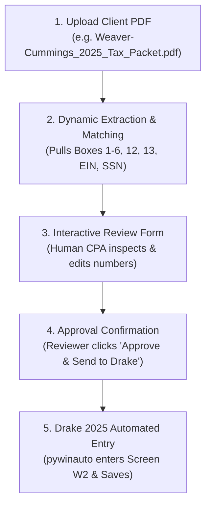

# TaxFlow AI - Smart W-2 Extractor, Reviewer & Drake Entry Tool

This tool provides a custom, modern front-end for tax preparers to dynamically extract Form W-2 data from any client PDF, review & adjust fields, and approve them before sending them directly into **Drake Tax 2025**.

---

## The Complete Workflow

---

## Features

1. **Drag-and-Drop PDF Upload**:
   - Supports single W-2 forms or full multi-page client packets (like the 70-page `Weaver-Cummings_2025_Tax_Packet.pdf`).
   - "Load Sample" button for one-click testing.

2. **Automated W-2 Extraction**:
   - Employee SSN, Full Name, and Street Address.
   - Employer EIN, Legal Name, and Address.
   - Box 1 Wages, Box 2 Federal Withholding.
   - Box 3 Social Security Wages, Box 4 Social Security Tax.
   - Box 5 Medicare Wages, Box 6 Medicare Tax.
   - Box 12a Code (D) & Amount, Box 12b Code (DD) & Amount.
   - Box 13 Retirement Plan indicator.

3. **Human-in-the-Loop Review Screen**:
   - Side-by-side verification.
   - All fields are editable so the preparer can make quick corrections or add notes.

4. **Approval & Direct Drake 2025 Entry**:
   - Opens or creates the return for the client.
   - Navigates to Screen `W2`.
   - Fills in each box and clicks Save.
   - Live execution logs stream back to the dashboard.

---

## How to Launch the Tool

1. Double click **`start_tool.bat`** in this folder:
   `C:\Users\Zen\OneDrive\Documents\Drake Automation\Drake-Automation\Tax_Extraction_Tool\start_tool.bat`
2. It automatically starts the server and opens your browser at:
   `http://127.0.0.1:5000`
