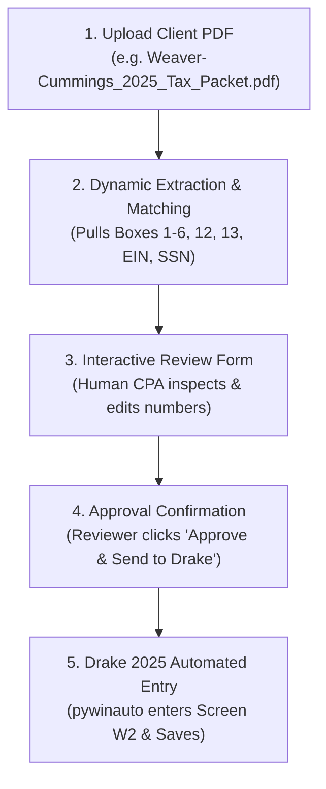

# TaxFlow AI - Smart W-2 Extractor, Reviewer & Drake Entry Tool

> **New: the full-packet review workflow lives at `http://127.0.0.1:5050/review`** (and `/drake-modules` now opens it).
> See [Full tax-packet workflow (`/review`)](#full-tax-packet-workflow-review) below.

This tool provides a custom, modern front-end for tax preparers to dynamically extract Form W-2 data from any client PDF, review & adjust fields, and approve them before sending them directly into **Drake Tax 2025**.

---

## The Complete Workflow

---

## Features

1. **Drag-and-Drop PDF Upload**:
   - Supports single W-2 forms or full multi-page client packets (like the 70-page `Weaver-Cummings_2025_Tax_Packet.pdf`).
   - "Load Sample" button for one-click testing.

2. **Automated W-2 Extraction**:
   - Employee SSN, Full Name, and Street Address.
   - Employer EIN, Legal Name, and Address.
   - Box 1 Wages, Box 2 Federal Withholding.
   - Box 3 Social Security Wages, Box 4 Social Security Tax.
   - Box 5 Medicare Wages, Box 6 Medicare Tax.
   - Box 12a Code (D) & Amount, Box 12b Code (DD) & Amount.
   - Box 13 Retirement Plan indicator.

3. **Human-in-the-Loop Review Screen**:
   - Side-by-side verification.
   - All fields are editable so the preparer can make quick corrections or add notes.

4. **Approval & Direct Drake 2025 Entry**:
   - Opens or creates the return for the client.
   - Navigates to Screen `W2`.
   - Fills in each box and clicks Save.
   - Live execution logs stream back to the dashboard.

---

## How to Launch the Tool

1. Double click **`start_tool.bat`** in this folder:
   `C:\Users\Zen\OneDrive\Documents\Drake Automation\Drake-Automation\Tax_Extraction_Tool\start_tool.bat`
2. It automatically starts the server and opens your browser at:
   `http://127.0.0.1:5000`

---

## Full tax-packet workflow (`/review`)

`python app.py`, then open **http://127.0.0.1:5050/review**. One guided pipeline, one step at a time:

**Upload PDF → Analyze → General → Income → Adjustments → … (one step per Drake module found) → Final review → Transfer to Drake**

| Step | What happens |
|---|---|
| Upload | Any PDF. Every page is read; the analysis starts immediately. |
| Analyze | Each page is classified, forms are split out (brokerage composite statements are cut into their 1099-DIV / INT / MISC / OID / B sections), every field is extracted with its page and position. Shows a page map, the forms per Drake module, duplicates, tax-year mismatches and cross-form checks. |
| Module steps | Drake-style Data Entry window: module tabs, one chip per form (`INT 2/5` = Drake record 2 of 5), the original PDF on the left with every value boxed. W-2 uses the exact Drake Screen W2 layout; other screens are Drake-styled from the catalog. **Field mapping** tab shows PDF values ↔ Drake fields with arrows; drag any PDF value (box on the page or list item) onto a Drake field, or *Match remaining*. Confirm values (✓), then **Mark form reviewed** — Next/Previous move through every form and module. |
| Final review | Every form reviewed or excluded; counts of confirmed values and which have a linked Drake field. |
| Transfer | Dry run (no Drake) or real transfer: opens/creates the return by the Screen 1 SSN, enters each confirmed value on its screen + record, reads it back, and reports *verified / mismatch / failed / not linked / blocked / reference only* per field. 1099-B sale lots are written as a Drake Form 8949 import file. |

Rules that are enforced on the server: only **reviewed**, non-excluded forms and only **confirmed** values are sent; a form with invalid or missing required values can't be marked reviewed; a Drake record that already has data is not overwritten unless *Overwrite* is ticked; nothing is skipped silently.

### Supported documents
W-2, W-2G, 1099-INT, 1099-DIV, 1099-R, 1099-MISC, 1099-NEC, 1099-G, 1099-K, 1099-B (+ lots / 8949), 1099-OID, 1099-SA, 1099-Q, SSA-1099 / SSA-1042S, 1098, 1098-E, 1098-T, 5498, 5498-SA, 1095-A/B/C, Schedule K-1 (1065, 1120-S), brokerage composite statements.
Derived screens: Screen 1 (taxpayer/spouse from the forms, T/S code on every form) and Form 1116 (foreign tax from composite statements).
Unrecognised pages become *Miscellaneous* documents: every value found on them is listed for manual mapping, and the reviewer can choose the form type. Scanned pages are OCR'd when `pytesseract` + Tesseract are installed, otherwise flagged for manual entry.

### Drake field ids ("Link Drake fields")
Values are typed into Drake only through UI-Automation ids. Ids already used by the existing automation (W2, INT, DIV, 1099-R, 99M, OID, SSA, A) are built in. For any other screen open a return in Drake, go to that form in `/review` and click **🔗 Link Drake fields**: the tool opens the Drake screen, reads every input and its label, suggests the matches, and saves the confirmed links in `taxflow_drake_links.json` (reused for every client).

### Code layout (`taxflow/`)
| File | Purpose |
|---|---|
| `catalog.py` | Form catalog — detection patterns, fields (label patterns, value type, box), Drake module/screen/ids. **Add a form here.** |
| `pdftext.py` | Positioned text model (pdfplumber), optional OCR. |
| `extract.py` | Layout-independent extraction: label → value on the same line or below in the same box, name/address blocks, check boxes, tables, composite statements, 1099-B lots, generic label/value pairs. |
| `derive.py` | Packet level: tax year, taxpayer/spouse + T/S, Screen 1, Form 1116, duplicates, reconciliations, Drake record numbers. |
| `validate.py` | Format rules Drake accepts + per-form consistency checks. |
| `session.py` | Review sessions (`uploads/sessions/*.json`), confirmations, learned mappings (`taxflow_learned_mappings.json`). |
| `transfer.py` | Drake transfer with read-back, dry run, Drake field discovery. |
| `routes.py` + `templates/review.html` + `static/review/` | The `/review` UI and API. |
